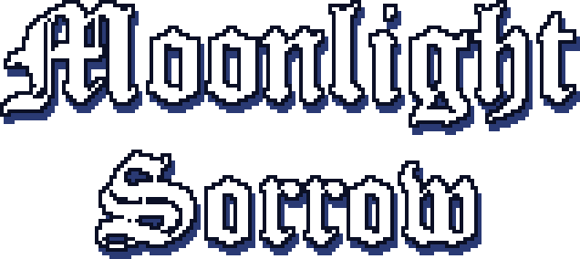
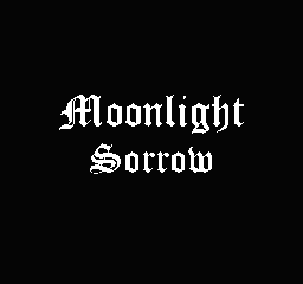
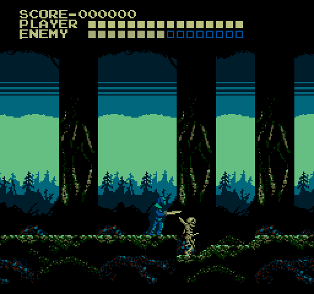

  

  <b>A gothic action platformer for the NES, in the spirit of the classic Castlevania games.</b>

  
  
  
  

## About

**Moonlight Sorrow** is a homebrew game for the Nintendo Entertainment System.
Take up your sword and make your way through a moonlit forest where skeletons
walk and bats circle in the dark.

It's a real NES game, made the way games were made for the console: it runs in
any NES emulator, and it's built for the same MMC1 cartridge chip used by
classics like *The Legend of Zelda* and *Metroid*.

## Features

- **Sword combat**: strike standing or crouching, and time your swings, since
  every enemy has to be in reach.
- **Classic movement**: deliberate, committed jumps and a hard knockback when
  you take a hit, just like the games that inspired it.
- **A scrolling forest stage**, drawn tile by tile in pixel art.
- **Enemies**: skeletons that close in along the ground and bats that swoop
  through the trees.
- **A classic status bar** with your score, your health and the health of the
  last enemy you struck.
- **An original chiptune soundtrack** and sound effects, written for the NES's
  own sound chip.

## Screenshots

| Title screen | In the forest |
|:---:|:---:|
|  |  |

## Controls

| Button | Action |
|---|---|
| D-pad left / right | Walk |
| D-pad down | Crouch |
| A | Jump |
| B | Attack (hold down to attack while crouching) |
| Start or Select | Start the game from the title screen |

## Play it

Moonlight Sorrow is in development and builds from source:

1. Install [cc65](https://cc65.github.io) and `make`.
2. Run `make` in this folder. You get `build/moonlight.nes`.
3. Open it in an NES emulator, such as [Mesen](https://www.mesen.ca), or
   [NES-Emulator](https://github.com/TSS71998/NES-Emulator), the emulator I wrote
   alongside this game.

## Status

Early but playable: the first stage is in, with enemies, combat, a title
screen and music. More is on the way.

## Made with

- **Code**: C and 6502 assembly, built with [cc65](https://cc65.github.io)
- **Graphics**: [NEXXT](https://frankengraphics.itch.io/nexxt) and
  [Aseprite](https://www.aseprite.org)
- **Music and sound**: [FamiStudio](https://famistudio.org), played by the
  FamiStudio sound engine (MIT license)
- **Testing**: [NES-Emulator](https://github.com/TSS71998/NES-Emulator) and
  [Mesen](https://www.mesen.ca)

## For developers

How the game is put together (the cartridge layout, levels, the HUD,
enemies, music, and how to add your own) is in
[docs/DEVELOPMENT.md](docs/DEVELOPMENT.md).

---

Created by <a href="https://github.com/TSS71998">TSS71998</a>

